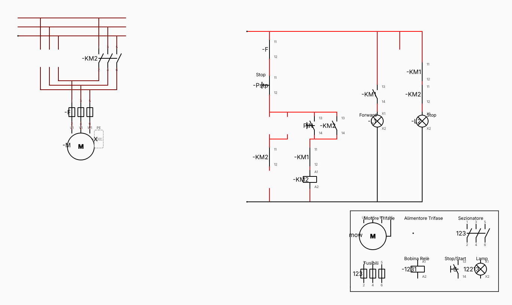

# bettercadesimu

A clean-room, cross-platform replacement for the proprietary **CADe SIMU** relay-logic
schematic tool, built with C++20 and Qt 6.



The goal is to re-create the *functionality* — drawing IEC motor-control schematics,
simulating contactor/relay logic, and testing control circuits — without copying any
proprietary code, symbols, or assets. The original application is closed-source freeware;
this project only reads its plain-text `.cad` document format for interoperability and
draws its own symbols from scratch.

> Not affiliated with, endorsed by, or derived from CADe SIMU.

## Status

Early work in progress. This milestone (M0) is a **read-only viewer**:

- `.cad` parser that replays the append-only record log by object ID.
- Pan / zoom / fit-to-window canvas with a snap-style grid.
- Rubber-band selection in every direction, plus hover highlight.
- Inspector dock showing the raw type field and all 23 numeric fields.
- CLI modes for dumping a parsed document and rendering it to PNG.
- Drag-and-drop and recent-files support.

Editing, simulation, and a native JSON project format come next.

## Requirements

- CMake 3.21+
- Ninja (or another generator)
- Qt 6.5+ with the Widgets module
- A C++20 compiler

On Arch/Omarchy:

```sh
sudo pacman -S --needed cmake ninja qt6-base
```

## Build

```sh
cmake -S . -B build -G Ninja -DCMAKE_BUILD_TYPE=RelWithDebInfo
cmake --build build
```

## Run

Open the viewer:

```sh
./build/bettercadesimu
./build/bettercadesimu "path/to/schematic"
```

Print the parsed records:

```sh
./build/bettercadesimu --dump "path/to/schematic"
```

Render a PNG (works headlessly; forces the offscreen Qt platform):

```sh
./build/bettercadesimu --render out.png "path/to/schematic"
```

## Tests

```sh
ctest --test-dir build --output-on-failure
```

Optionally point the suite at a real schematic:

```sh
BETTERCADESIMU_FIXTURE="path/to/schematic" ./build/cad_parser_test
```

## Reading the `.cad` format

A `.cad` file is Latin-1-ish plain text:

```
CADe_SIMU*<record>*<record>*...$$$<metadata>
```

Each record has exactly 25 `*`-separated tokens:

| Tokens | Meaning |
| --- | --- |
| 0 | object ID |
| 1 | type field: `type#label#sublabel#pin#pin#...` |
| 2–24 | 23 numeric fields, optionally followed by `#text` |

Records form an append-only change log: a later record with the same ID overrides the
earlier one, so the last definition wins. Geometry lives in fields 8–11:

- Lines and wires use them as `x1, y1, x2, y2`.
- Components use fields 8–9 as the insertion point and 12–15 as a local bounding box.
- Text uses them as a text box.

Coordinates are rendered at 4 px per file unit, which matches the dimensions of PNGs
exported by the original application. The insertion point of a component is its first
pin; additional poles sit 6 units to the right.

## Layout

```
src/cad/        format parser and data model
src/ui/         Qt canvas, symbol painting, main window
tests/          parser unit tests
```

## Licence

TBD. The source code in this repository is original work.
